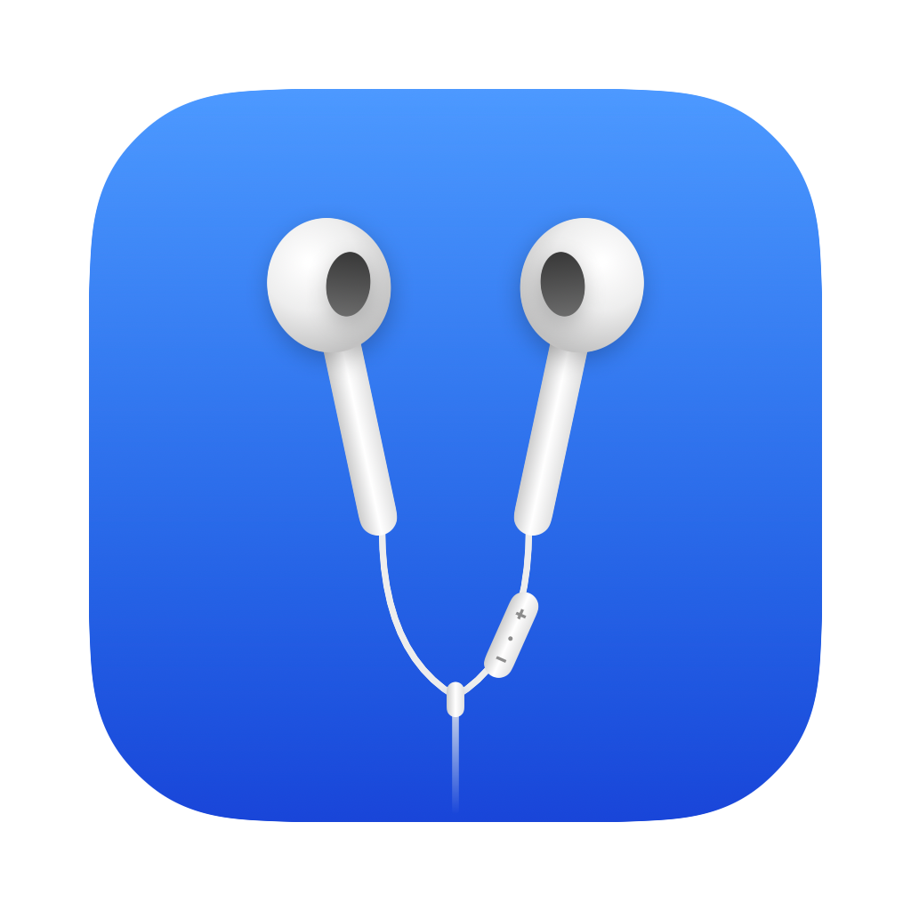
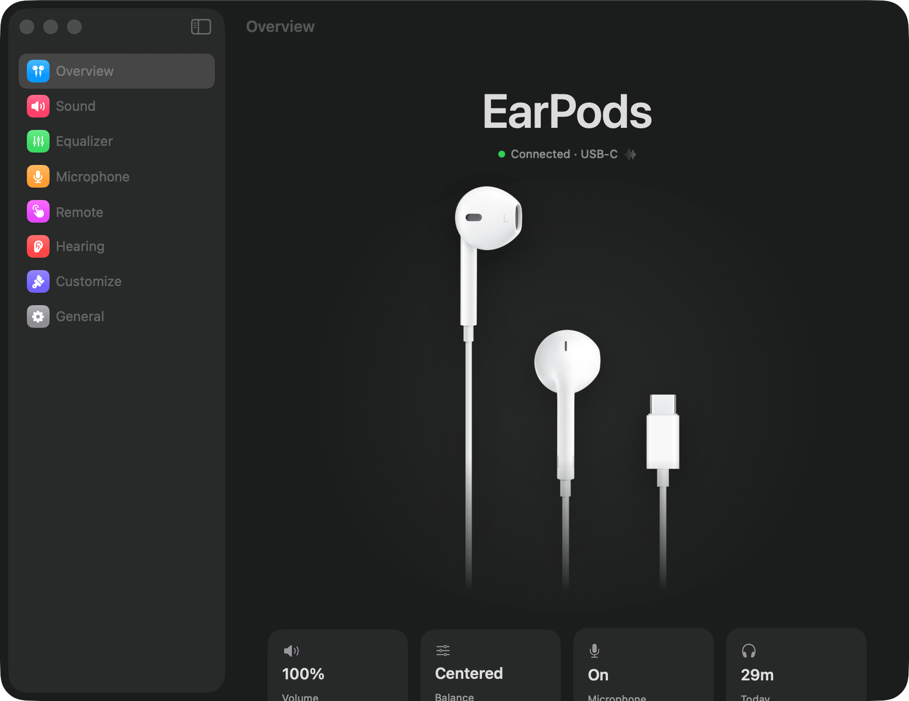
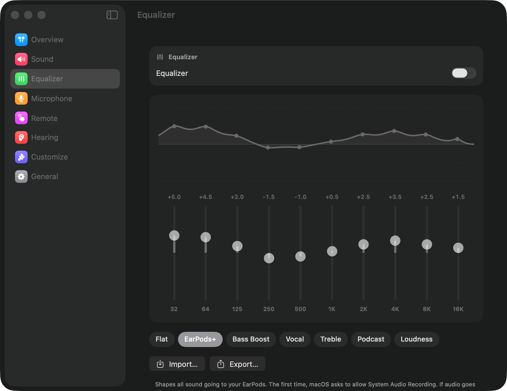
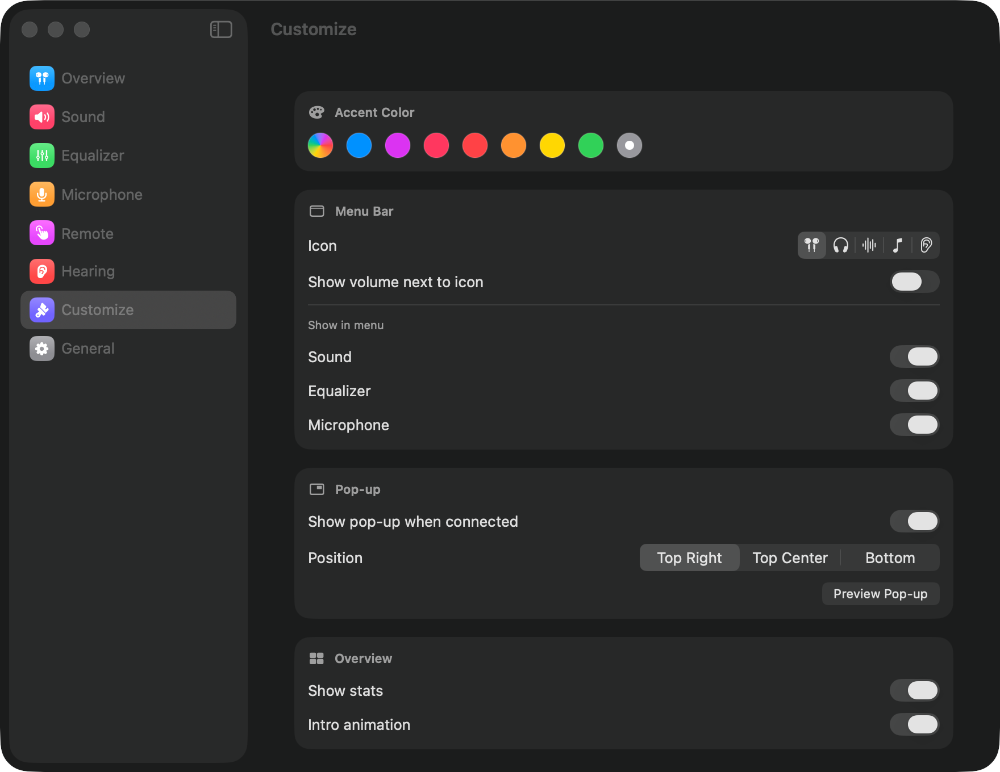

<p align="center">
  
</p>

<h1 align="center">EarPods Control</h1>

<p align="center">
  <b>The missing control center for wired Apple EarPods on the Mac.</b><br>
  System-wide EQ, remappable remote buttons, hearing protection, and a menu bar that just works.
</p>

<p align="center">
  
</p>

AirPods get a whole settings page. Wired EarPods get… nothing. EarPods Control fixes that. It's a free, native macOS app that gives your EarPods (USB-C or 3.5 mm) the controls they always deserved.

## ✨ What it does

| | |
|---|---|
| 🎚 **System-wide equalizer** | 10 bands, a live response curve, and presets like **EarPods+** (deep bass and clear voices). Works for every app: Music, Spotify, YouTube, games. |
| 💾 **Share your EQ** | Export your sound as a small `.json` file and import other people's. A few to start with are in [`EQs/`](EQs). |
| 🎛 **Remap the remote** | Make click, double-click and triple-click do what *you* want: mute your mic in calls, open Siri, run any **Shortcut**, skip tracks… |
| 🔉 **Finer volume steps** | Make the + / − buttons move in 1–10% steps for precise control at low volume. |
| 👂 **Hearing protection** | Cap the maximum volume, and see how long (and how loud) you listened each day. |
| 🎙 **Microphone** | Live input meter, mic level, one-click mute, and automatic switching to the EarPods mic. |
| ⚖️ **Balance & channel test** | Left/right balance plus a test tone for each ear. |
| ⏸ **Smart automation** | Pauses your music when you unplug. A clean pop-up shows when you plug in. |
| 🎨 **Make it yours** | Accent color, menu bar icon, which controls the menu shows, pop-up position. |

<p align="center">
  
  
</p>

## 📦 Install

**Requirements:** macOS 15 Sequoia or newer, on an Apple Silicon or Intel Mac.

### Option 1: Download (easiest)

1. Download **`EarPods-Control.zip`** from the [latest release](../../releases/latest) and open it.
2. Drag **EarPods Control** into your **Applications** folder.
3. Open it. macOS will say it can't verify the app, because it isn't from the App Store. Click **Done**, then go to
   **System Settings → Privacy & Security**, scroll down, and click **Open Anyway** next to EarPods Control.
   You only do this once.

Look for the EarPods icon in your menu bar. 🎧

### Option 2: Build it yourself (about 1 minute)

```bash
xcode-select --install          # Apple's free command line tools, if you don't have them
git clone <this repository's URL>
cd EarPodsControl
zsh build.sh                    # builds, installs to /Applications, and opens the app
```

You don't need Xcode or any other dependencies.

## 🔐 Permissions (all optional)

The app only asks when you turn on a feature that needs it:

| Permission | Used for |
|---|---|
| **Accessibility** | Seeing and remapping the remote buttons (Remote page) |
| **System Audio Recording** | The equalizer, which processes your Mac's sound before it reaches the EarPods |
| **Microphone** | The live input meter on the Microphone page |

## 🛡 Privacy

- No accounts, no analytics, no tracking. Your settings and listening stats never leave your Mac.
- The app makes exactly **one kind of network request**: on first launch it downloads two EarPods product photos from Apple's website (`apple.com`) and caches them in `~/Library/Application Support/EarPods Control`. If you're offline, you'll see a simple EarPods symbol instead.

## 🎛 EQ files

An EQ is a tiny, human-readable file, so you can make one by hand:

```json
{
  "name": "Clear Bass",
  "frequencies": [32, 64, 125, 250, 500, 1000, 2000, 4000, 8000, 16000],
  "gains": [5, 4.5, 2, -1.5, -1, 0.5, 2.5, 3.5, 2.5, 1.5]
}
```

Gains are in dB, from −12 to +12. Use **Equalizer → Import…** to load one and **Export…** to share yours. Made a great one? Open a pull request and add it to [`EQs/`](EQs)!

## 🩺 Troubleshooting

<details>
<summary><b>The remote buttons don't respond / the Remote page keeps asking for access</b></summary>

macOS ties the permission to the exact copy of the app you approved, so it can go stale after an update. On the Remote page, click **Already on? Reset**, then turn EarPods Control on in the list that opens.
</details>

<details>
<summary><b>Sound went silent after turning on the equalizer</b></summary>

Turn the equalizer off. Then allow EarPods Control in **System Settings → Privacy & Security → Screen & System Audio Recording**, and turn the equalizer back on.
</details>

<details>
<summary><b>My 3.5 mm EarPods aren't detected</b></summary>

USB-C EarPods are the most tested. 3.5 mm EarPods are recognized on Macs where the headphone jack shows up as its own "External Headphones" device (Apple Silicon). Intel Macs report the jack differently, so they aren't detected yet. Please open an issue if yours aren't detected, and include your Mac model.
</details>

<details>
<summary><b>Remaps also change my keyboard's media keys</b></summary>

macOS doesn't say which device a play/next/volume key came from. So while EarPods are plugged in, remaps also apply to the keyboard's media keys. Unplug the EarPods and your keyboard is back to normal.
</details>

## 🧹 Uninstall

Quit the app from its menu bar icon, then:

```bash
rm -rf "/Applications/EarPods Control.app" ~/Library/Application\ Support/EarPods\ Control
defaults delete app.earpodscontrol.EarPodsControl
```

## 🛠 For developers

- Plain Swift and SwiftUI with Apple frameworks only (Core Audio process taps for the EQ, a `CGEventTap` for the remote). There's no Xcode project; `build.sh` calls `swiftc` directly.
- Every build runs a built-in self-test (`--selftest`) covering the EQ math, EQ file validation and the sample EQs.
- `DEV=1 zsh build.sh` keeps Accessibility permission across rebuilds while you hack. Don't ship those builds.
- The app icon is an original drawing. Regenerate it with `swift scripts/make-icon.swift Resources/AppIcon.png`.

Issues and pull requests are welcome!

## ⚖️ Legal

EarPods Control is an independent project. It is **not affiliated with, endorsed by, or sponsored by Apple Inc.**
EarPods, AirPods, Mac and macOS are trademarks of Apple Inc. The EarPods product photos shown in the app belong to Apple. They are not included in this repository or in releases; the app downloads them from apple.com on your Mac.

Released under the [MIT License](LICENSE).
